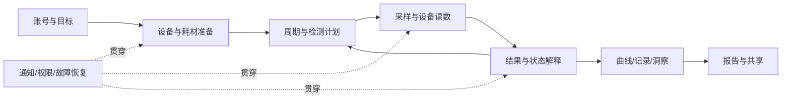

# Inito 与 Mira 软件功能拆分及基础竞品分析

**用途**：为相关生育力/激素追踪软件规划提供功能地图、交互边界和待验证决策。**研究截止**：2026-10-20。**状态**：研究稿，非已冻结 PRD。事实与来源见[事实账本](./evidence.md)。

## 1. 决策摘要

1. **两家软件都围绕“何时测、测出什么、意味着什么、接下来做什么”组织体验**。Inito 当前 InSight 以单棒四激素、Wi‑Fi 后台检测、五种状态和全周期图表形成连续任务链；Mira 以多棒型、设备配对后自动同步、可筛选/对照的曲线、日历、手工补录与医生报告形成较宽的功能组合。Mira 连接介质需按设备型号进一步核验。这里是官方公开资料的功能比较，不是使用率或准确率比较。[CLM-01–18]
2. **“预测、实测、确认、人工修改”必须分层**。Inito 的 Waiting for PdG Rise 在首页和图表可有不同表述；Mira 的预测会随结果移动，且手工确认排卵会覆盖同周期既有预测/检测/确认信息。规划时须为状态来源、变更理由和影响范围建模。[CLM-05、14–15]
3. **设备路线直接改变 App 流程**。Inito 新读数器需要扫码/录码、Wi‑Fi 配网、后台检测和结果通知；Mira 需要设备配对、自动同步与 Ultra4 使用前软件更新。连接方式不是单纯设置项，而是测试任务的前置条件和故障恢复逻辑。[CLM-01、03–04、10]
4. **可分享性有明确门槛和产物差异**。Inito 的彩色/黑白图表 PDF 需要至少一个完整检测周期；Mira 的 Doctor’s Report 至少需 3 个月 Monitor 测试。Mira 另有普通图表导出入口，不能把不同导出产物的门槛混为一谈。[CLM-06、11、18]

## 2. 范围与读法

- 基准：美国公开资料；Inito 当前 **InSight Wireless Reader**（2026-04 发布）和对应 App；Mira App 配 **Mira Analyzer/Monitor**，以 Ultra4 为四激素主线，保留 Max 等棒型差异。Mira 围绝经模式与 Cortisol beta 作为相邻模式单列，不混入备孕默认流程。[CLM-01–02、09、20–21]
- **页面名称是研究归类**。仅当官方明确称 Home、Calendar、Chart、My devices、Reports and Connections 等，才视作实际入口名称；表中的“测试准备页”等只表示任务节点，未声称当前底部导航长这样。
- 证据级别：**A** = 官方写出控件/步骤；**B** = 官方确认功能，但没有足够证据锁定控件位置或状态规则；**U** = 未查到，须实机/账号/厂商确认。所有 A/B 都需要指定 App build 回归测试。
- 本稿拆分公开资料能够定位的功能域，**不能证明覆盖登录后所有页面和灰度权益**。资料缺口不是“竞品不支持”。不可把以下软件规划建议写成竞品已有能力。

### 2.1 研究用页面流

## 3. Inito：按页面、模块、控件与交互拆分

**代际约束**：以下以独立 InSight 为准；旧手机夹具版的相机和常驻手机流程不适用。[CLM-01]

| 页面/任务节点 | 模块与页面内控件 | 控件功能、功能交互及状态边界 | 证据/级别 |
| --- | --- | --- | --- |
| I-P01 引导/注册 | 下载、注册入口；`I Have Fertility Monitor` | 完成注册后，已有设备用户从引导末页进入添加设备。账号验证、跳过与恢复规则未公开。 | CLM-03 / A；细节 U |
| I-P01 引导/注册 | 盒内二维码扫描、手工码、`Add Fertility Monitor` | 两条设备编码输入路径汇合到添加动作；扫码失败后的人工输入是可见回退。编码错误文案/绑定冲突未公开。 | CLM-03 / A |
| I-P01 引导/注册 | 既往周期日期录入 | 提供历史月经/周期信息，为第一轮计划建立初始背景。必填项、日期校验和后续编辑位置未公开。 | CLM-03 / A；校验 U |
| I-P02 设备设置 | 读数器引导、Wi‑Fi 列表、密码输入 | 添加 InSight 并选网络配网。当前公开材料未写断网缓存、换路由器、密码错误或多设备切换规则。 | CLM-01、03 / A；恢复 U |
| I-P03 首页/今日 | 当日生育状态卡 | 官网/指南列出 Low、High、Peak、Waiting for PdG Rise、Ovulation Confirmed。状态是结果解释层，不应直接等同每项激素原值；Waiting 在图表可对应 Low。 | CLM-05 / A |
| I-P03 首页/今日 | 当日结果与测试状态 | 官方明确首页可显示 Waiting for PdG Rise；检测运行时可回 App 查看任务状态，但状态入口是否位于首页未证实。完成时推送并自动呈现结果；后台可使用手机。 | CLM-04–05 / 状态行为 A；位置 U |
| I-P03 首页/今日 | 下一步提示/个性化解释 | 官方称基于个人基线解释不同峰型、早/晚排卵。具体推荐卡位置、算法阈值、解释版本未公开。 | CLM-07 / B |
| I-P04 日历/检测计划 | 检测日标记；日历入口 | 官方指南称日历高亮应测日期，由 App 指导哪天测试；不应把示例 CD6 机械写成所有用户的固定日程。漏测后如何重排未公开。 | CLM-04 / A；重排 U |
| I-P04 日历/检测计划 | 周期日期 | 首次可录入既往周期日期；后续月经起止编辑、跨时区归属、长周期边界未找到明确步骤。 | CLM-03 / A；后续 U |
| I-P05 发起检测 | `Take a Test` | 从 App 发起，页面引导收集样本、浸棒、盖帽、启动设备、插棒。采样动作仍在物理世界完成，App 不能仅凭按钮判断读数成功。 | CLM-04 / A |
| I-P05 发起检测 | 15 秒浸棒计时器 | App 计时辅助标准化采样；完成计时不代表设备已读数。超时、重来、意外切后台的计时行为未公开。 | CLM-04 / A；边界 U |
| I-P05 发起检测 | 设备运行/进度与结果通知 | 插棒后设备在 Wi‑Fi 范围运行，手机可离开；App 可看状态，完成后通知并自动同步。通知被拒、设备离线及重复回传规则未公开。 | CLM-04、23 / A/U |
| I-P06 结果详情 | 数值卡及五类状态 | 同次测试对应 E3G、LH、PdG、FSH 数值和周期解释；High/Peak 是备孕窗口提示，Ovulation Confirmed 基于后续 PdG 趋势。不要把单日 PdG 值当独立确认。 | CLM-02、05 / A |
| I-P06 结果详情 | Waiting for PdG Rise | 指南写明首页可见 Waiting，图表此时显示 Low；对同一日有“当前怀孕机会”和“排卵证据进度”两层语义。 | CLM-05 / A |
| I-P07 图表 | 四激素曲线、周期日轴、图例 | 每次测试增加数据点；E3G 绿、LH 紫、PdG 蓝、FSH 橙，图例位于右上。具体缩放、点按数值、筛选激素的当前控件未公开。 | CLM-06 / A；筛选 U |
| I-P07 图表 | 日状态带/周期比较 | 图表显示高峰与确认标签；可随日结果更新。跨周期对照控件的位置/类型未由当前来源证实。 | CLM-05–06 / A/B |
| I-P07 图表 | 右上分享图标、彩色/黑白选择、PDF 保存/发送 | 至少一个完整检测周期后可导出；未满门槛时的错误/禁用文案与报告数据范围待实机。 | CLM-06 / A；门槛 UI U |
| I-P08 生活记录 | 症状、性生活、用药、妊娠测试记录 | 在售产品页确认四类记录可与检测结果放在同一处；没有公开页面步骤，不确定是独立页面或日历中的表单。 | CLM-07 / B |
| I-P09 提醒 | 按周期智能提醒 | 官方称提醒基于周期而非固定日历日期；已证实结果完成通知。类别开关、具体时间、静默和系统授权路径未查到。 | CLM-04、07、23 / B/U |
| I-P10 账号/支持 | 账号管理、隐私、数据生命周期 | 注册得到确认；健康数据删除、跨设备登录、用户自行导出原始记录等完整路径未从本次来源定位。留作验证清单，不写“不支持”。 | CLM-03、23 / U |

## 4. Mira：按页面、模块、控件与交互拆分

**耗材约束**：Ultra4、Max、Plus、Confirm、Ovum 所测项目不同；同一 App 图表的可用曲线取决于实际棒型。Ultra4 使用前可能要求 Monitor 软件更新。[CLM-09–10]

| 页面/任务节点 | 模块与页面内控件 | 控件功能、功能交互及状态边界 | 证据/级别 |
| --- | --- | --- | --- |
| M-P01 首次使用/目标 | App 下载、无 Monitor 基础使用 | Mira App 可单独使用；但没有设备时不能推定有真实激素读数。首次引导的逐屏问题与跳过路径未从公开资料锁定。 | CLM-08 / B |
| M-P01 首次使用/目标 | App 菜单 → Health Profile → Fertility Goal | 进入目标列表，选择后用底部 OK 确认。目标切换对历史预测/提醒的即时影响未公开。 | M20 / A；影响 U |
| M-P02 首页/今日 | 日历快捷入口、加号 `Log Data` | 首页右上日历可进入周期视图；加号可快速到月经、症状、BBT 等记录。帮助文章对加号位置有不同描述，入口名称可靠，像素位置待实机。 | CLM-13、16 / A |
| M-P02 首页/今日 | Fertility Status、1–10 Fertility Score | 官方将两者作为周期/激素数据的解释；1–10 是日生育力分数，不可写成怀孕概率百分比。数值解释样式待实机。 | CLM-15 / A |
| M-P02 首页/今日 | 测试、BBT、日志快捷入口 | 官方帮助目录明确有从首页直接访问上述任务的更新；实际版式和全部入口未做实机验证。 | M25 / B |
| M-P02 首页/今日 | 周期轮下方的下一次测试提示 | 首页可查看推荐测试日与棒型；从底部加号进入 `Test hormones` 也可查看。计划个性化，不是一套固定日期。 | CLM-25 / A |
| M-P03 日历 | 日期选择、真实月经 `Edit Period` | 首页或日历可进入编辑，调整真实月经日期并保存；日期变更如何重算预测和提醒，未公开细节。 | CLM-13 / A |
| M-P03 日历 | 预测月经标记 | 官方称当前不能直接移除预测月经；真正经期录入后更新，且预测月经不会改变检测计划或数据分析。UI 要与已记录经期区别表达。 | CLM-13 / A |
| M-P03 日历 | 编辑周期 → 排卵日期 → 理由 → 确认 | 当前帮助页允许手工确认非月经日，且会清除同周期已有预测/检测/确认排卵信息，每周期仅可加一个。高影响覆盖操作的二次确认、撤销和历史留痕待实机。 | CLM-14 / A；回退 U |
| M-P03 日历 | 易孕窗口/排卵预测及推荐检测日标点 | 初始依据周期特征，加入激素结果后会调整；LH 峰与预计日不一致时预测移动。日历用标点提示推荐测试日；预测与实测来源应区分。 | CLM-15、25 / A |
| M-P04 检测计划 | 推荐何时测、该用何种棒 | 首页周期轮下、加号 `Test hormones`、日历标点和当日 Tip 均可获取计划信息；当天建议棒型在周期轮下或 Test hormones 中查看。具体调度算法与跳过后处理待核。 | CLM-25 / A；算法 U |
| M-P04 检测计划 | 浸棒计时器 | 官方帮助称新增 Wand-dipping Timer；具体计时秒数与后台行为本次未核。 | M25 / B |
| M-P05 我的设备 | App 菜单 → `My devices` → Mira Analyzer → Connect | 设备弹出按主键确认，配对成功 App 提示；之后结果自动同步。连接介质、连接失败与系统权限异常须按型号实机核对。 | CLM-10 / 配对及同步 A；介质 U |
| M-P05 我的设备 | Monitor → `Update software` / `Update Now` | Ultra4 棒使用前可能提示升级；未弹出时可在 My devices 手动更新。官方提醒不更新可能影响读数并浪费耗材。最低固件号/失败恢复未公开。 | CLM-10、24 / A/U |
| M-P06 图表/结果 | 激素曲线、图表下方激素选项 | 默认显示本次棒型测得的全部激素；点选某一项/多项显示，复点反选。不同棒型缺曲线不能当零值。 | CLM-09、11 / A |
| M-P06 图表/结果 | `Compare` 与对照类型 | 先选激素，再选对照类型，个人曲线与所选人群平均数据叠加；对照群体定义、样本量和误差范围未公开。 | CLM-11 / A；统计边界 U |
| M-P06 图表/结果 | 当日 `Mira Tip` | 图表下方展示仅供当前日的 Tip；点开可读结果、生育状态和建议，并了解后续推荐测试。旧日期是否可回看 Tip 待实机。 | CLM-25–26 / A；回看 U |
| M-P06 图表/结果 | 图表右上导出、图表底部报告入口 | 普通图表导出与 Doctor’s Report 两种不同产物；前者帮助页未明确文件格式，后者明确 PDF 和三个月门槛。 | CLM-11、18 / A |
| M-P06 图表/结果 | 三点菜单 `Add new measurement` | 同步失败时选择棒型、日期时间、各激素值和对应 Monitor 显示屏照片；Next 复核后 Edit 或 Confirm and Send。手工记录与设备同步结果的去重规则未公开。 | CLM-12 / A；去重 U |
| M-P07 日志 | 首页加号/图表底部/日历日 → Symptoms | 三条入口到同一记录任务；从选中的日期发起时需注意日期归属。官方未公布症状全部枚举与编辑/删除规则。 | CLM-16 / A；字段 U |
| M-P07 日志 | BBT 时间、温度、°F/°C、Save | 手工补录体温；时间与单位可设定。跨时区转换、重复测量或异常温度校验待实机。 | CLM-16 / A；边界 U |
| M-P08 通知中心/提醒 | 通知图标、设置、开关、时间控件 | 系统层需授权，App 内可开关提醒并选接收时间；官方文档另有 App 菜单 → Reminders 路径。菜单图标方位在帮助文章间不一致。 | CLM-17 / A |
| M-P09 报告与连接 | `Generate Report`、时间范围、预览/PDF 下载 | 菜单 Reports and Connections 或图表底部进入；Doctor’s Report 包含周期、激素、症状，至少 3 个月 Monitor 测试。失败重试与范围边界待实机。 | CLM-18 / A |
| M-P09 报告与连接 | `Cycle analysis` | 个人菜单 → Reports and Connections → Cycle analysis；当前来源仅确认入口，内容结构与报告关系待实机。 | CLM-26 / A；内容 U |
| M-P09 报告与连接 | `Invite a partner`、邀请邮件 | 输入伴侣信息发送邀请，对方通过邮件激活并建 Partner Account；官方描述只读、仅一人。撤销、邀请过期和不同账号登录时的隔离待核。 | CLM-19、24 / A/U |
| M-P10 健康模式 | Menopause Mode 的阶段线索/信心、HRT 背景、症状、提醒、扩展问卷 | Ultra4 普通版与围绝经版硬件相同，App 体验不同；阶段线索不能当诊断。此模式不应复制到普通备孕首页默认展示。 | CLM-20 / A |
| M-P11 扩展测试（beta） | Cortisol 采样计划、个人基线、Stress Signal、昼夜节律图、当日问卷 | 公开帮助称约 7 次检测建基线；一天至少两次才显示昼夜图；当日问卷目前不可跳过且参与分数。只限 beta 健康信息，不作为诊断功能。 | CLM-21 / A |
| M-P12 数据/支持 | 已同步 Monitor 结果的删除 | 当前 App 无用户自行删除入口，需联系客服；这是明确限制。手工补录记录的删除和修改规则仍未确认。 | CLM-22 / A；手工记录 U |
| M-P12 账户资料 | 个人菜单 → 姓名 → 资料项 → 确认 | 官方帮助列出头像、姓名、出生日期、电邮和密码可编辑；密码修改的验证流程和数据导出/注销路径待核。 | CLM-27 / A；流程 U |

### 4.1 需要特别区分的四种数据对象

| 数据对象 | 产生方式 | 竞品已确认的操作 | 规划提醒 |
| --- | --- | --- | --- |
| 设备测量值 | Inito Wi‑Fi 自动传/ Mira 配对后自动同步 | 图表、状态、报告；Mira 同步结果不可自行删除 | 保存原始数值、时间、棒型/设备与来源；不能因预测修改而改写原始测量。[CLM-04、10、22] |
| 手工补录测量 | Mira Monitor 有结果但未同步 | Mira 可录数值、时间、照片并复核 | 要处理后续自动同步的同次测量对账，规则目前未知。[CLM-12] |
| 预测与状态 | 周期史、激素和厂商算法 | Mira 预测会移动；Inito 有五种状态 | 分开记录“预测生成时间”“依赖数据”“状态解释”和“用户看到的版本”。[CLM-05、15] |
| 用户日志 | 症状、BBT、事件等 | 两家均有记录能力；Mira 路径更可定位 | 记录时间与测量时间可能不同；编辑历史及共享范围须单独定义。[CLM-07、16、19] |

## 5. 按用户任务的基础竞品分析

| 用户任务 | Inito 当前公开实现 | Mira 当前公开实现 | 对软件规划的意义 |
| --- | --- | --- | --- |
| 第一次开始追踪 | 设备码扫码/手输、Wi‑Fi 配网、既往周期输入。[CLM-03] | App 可无 Monitor 使用；目标可在 Health Profile 修改，设备另配对。[CLM-08、10；M20] | 要决定“先记录再连接设备”与“先建完整检测任务”如何衔接；不能让无设备态伪装为已有激素证据。 |
| 知道哪天测试 | 日历标检测日；App 指导日期。[CLM-04] | 首页周期轮下、`Test hormones`、日历标点和当日 Tip 有测试日/棒型指导，随数据调整预测。[CLM-15、25–26] | 任务建议要解释原因、适用棒型、今天漏测后的下一步；但具体算法要医疗/算法团队确认。 |
| 准确完成一次测量 | Inito App 15 秒计时，独立读数器后台工作，完成通知/自动同步。[CLM-04] | Mira Monitor 配对后自动同步；Ultra4 可能需先更新固件；支持同步失败后人工补录。[CLM-10、12] | 将“采样完成、设备读数、上传、解析、入账”拆成独立状态，针对不同硬件适配。 |
| 理解结果及行动 | Inito 提供数值、五类状态和四条曲线；Waiting 与图表 Low 语义不同。[CLM-05–06] | Mira 有 Fertility Status、1–10 分数、可选曲线与群体对照。[CLM-11、15] | 首页应同时显示当前行动解释与证据来源；分数/颜色之外提供文字，不把算法分数说成医学概率。 |
| 修正记录 | 公开资料未定位 Inito 的结果补录/删除路径。[CLM-23] | Mira 可改经期、手动确认排卵、补录设备值；已同步值需客服删除。[CLM-12–14、22] | 编辑必须明确是“更正用户记录”“新增人工测量”还是“改写推断”；高影响覆盖需事前解释及可追溯。 |
| 看趋势并带去就诊 | Inito 图表 PDF 可选彩色/黑白，至少一完整测试周期。[CLM-06] | Mira 普通图表导出；医生报告含周期、激素、症状，至少三个月测试。[CLM-11、18] | 定义轻量分享与医生报告两类产物、可用条件和隐私范围；不要把导出图表等同完整医疗报告。 |
| 共同参与或目标变化 | 本次未核出 Inito 伴侣只读账号/目标切换路径。[CLM-23] | Mira 有一人只读伴侣邀请，可切目标；围绝经为同硬件的不同 App 体验。[CLM-19–20；M20] | 共享和生活阶段模式的权限、历史与通知切换要独立设计，不能因竞品支持就默认进入 MVP。 |

## 6. 对相关软件规划的可迁移洞察（候选，不是已批准需求）

| 洞察 ID | 证据 → 推理 | 规划候选 | 反证/验证办法 |
| --- | --- | --- | --- |
| INS-01 任务连续性 | 两家都把计划、检测、结果、解释串联；Inito 后台检测仍可在 App 查看进度。[CLM-04、10] | 设计一个可恢复的检测任务 ID，区分“建议测试 / 已采样 / 读数中 / 已同步 / 需人工处理”。 | 实机测试用户是否常中断；设备协议能否提供可靠状态与重传 ID。 |
| INS-02 证据分层 | Inito 五状态与图表 Waiting/Low 不同；Mira 预测可移动且手工确认会覆盖旧信息。[CLM-05、14–15] | 数据模型区分测量、预测、确认、人工标注和展示态；改动提示具体影响的日期/结论。 | 实机检查两家状态更新时历史如何呈现；验证用户是否理解多层状态。 |
| INS-03 设备驱动 IA | Inito Wi‑Fi 独立读数器与 Mira 配对/固件升级的任务前置差别显著。[CLM-01、03–04、10] | 将设备、连接、固件、耗材兼容做为独立能力域，测试入口始终显示可测性及下一步。 | 硬件方案未定时只做抽象状态；由硬件/固件确定真实连接与离线能力。 |
| INS-04 趋势到报告 | 两家均提供纵向图表与 PDF，但门槛和产物不同。[CLM-06、11、18] | 提供不满足正式报告门槛时的可解释轻量分享；报告标明日期、单位、原始/手工来源。 | 用医生与用户访谈验证报告真正需要的字段和可读性；核法规与隐私边界。 |
| INS-05 模式隔离 | Mira 同硬件能提供普通跟踪、围绝经及 Cortisol beta 不同软件语境。[CLM-20–21] | 目标模式配置解释、提醒和图表，不在默认备孕体验堆放所有健康信号。 | 先明确目标人群与硬件测量范围；模式是否需要产品线分离。 |

**优先级说明**：上表按软件决策价值列候选，不代表研发 P0/P1。需要目标人群、硬件路线、监管边界、数据能力和成本信息后才能排期。

## 7. 截图/图表备注（用于评审页，不冒充实机截图）

| 备注 ID | 可定位画面 | 建议标注 | 限制 |
| --- | --- | --- | --- |
| SH-01 | I01「How the New Reader Compares」的新旧读数器表 | 框出 Wi‑Fi / Android+iOS / 手机依赖三行；在图注写“2026-04 新代际”。 | 厂商网页对比表，不是 App 屏幕。 |
| SH-02 | I03「What Does My Inito Chart Show?」四激素图与「Sharing Your Chart」导出步骤图 | 标注四条曲线颜色、周期日轴、右上图例和 PDF 分享入口。 | 官方示意图；导出门槛写在文字区而非图内。 |
| SH-03 | M09 图表导出帮助页内的截图 | 标注图表右上角导出控件。 | 只证明入口，不能从图片猜文件类型。 |
| SH-04 | M06 手工补录帮助页步骤与 M11 手工排卵帮助页 | 把“人工录值有照片与复核”和“手动排卵覆盖旧结论”作为两张不同流程卡。 | 当前来源是文字步骤；如放 App 截图需实机版本及账号状态。 |
| SH-05 | M21 Menopause Mode 功能小节与 M22 Cortisol beta 帮助页 | 在规划图上用独立分支标“同硬件不同模式”“beta 非诊断”。 | 不得放入默认备孕任务链或当医学结论。 |

## 8. 未完成的实机取证与研发决策

| 优先核实点 | 为什么影响规划 | 最小验证动作 |
| --- | --- | --- |
| 两家当前 App build、导航、账号权益、设备固件 | 页面和功能可因版本/地区/权益变化 | 各取一台美国区 iOS 和 Android；记录版本、账号态、设备/棒型、全导航截屏。 |
| 断网、配网失败、测量中退出 App、重复同步 | 决定任务状态与数据对账 | 用标准样本做断网/重连及重复上报；记录 App/设备两侧状态与结果 ID。 |
| Mira 手工确认排卵的覆盖警示、撤销及历史 | 高影响更正会改变预测与报告 | 在测试账号中完成一次有预测/确认数据的编辑，留全步骤和前后数据截图。 |
| Mira 手工补录后又自动同步、Inito 是否补录 | 可造成重复结果或丢失来源 | 同一检测先断连再补录，后重新同步；查看是否合并、覆盖或双条。 |
| 报告门槛、失败/重试及伴侣撤销 | 影响共享可信度与隐私 | 分别在未满/已满门槛账号、撤销共享前后测试，检查权限和链接。 |
| 两家预测/提醒的跨日、时区及漏测调整 | 决定任务何时触发及取消 | 用模拟时区/跨日和漏测测试，查看旧通知、计划与首页是否同时更新。 |

## 9. 第二挑战人格复核

独立挑战评审见[challenge-review.md](./challenge-review.md)。在缺少实机与账号证据前，结论仅供软件方向和验证计划使用，不作为完整当前 UI 的冻结基线。

